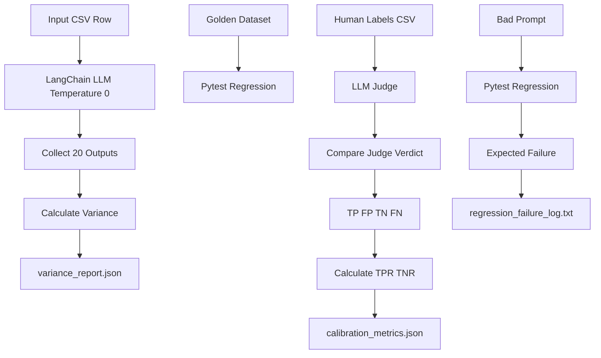

# LLM-as-Judge Calibration and Determinism Harness with LangChain and LangSmith

This project provides a comprehensive evaluation harness for Large Language Models (LLMs), focusing on determinism, regression testing, LLM-as-Judge calibration, and deliberate failure detection. Built with Python, LangChain, LangSmith, and Pytest, it offers a robust framework for assessing LLM performance and reliability.

## Overview

The harness is designed to provide deep insights into LLM behavior across several critical dimensions. It's structured into five distinct phases, each addressing a specific aspect of LLM evaluation, from output consistency to the accuracy of automated judgment.

## Evaluation Pipeline

The core evaluation pipeline follows a structured approach to process inputs, interact with LLMs, and generate detailed reports.



## Phase 1 — Determinism Measurement

This phase assesses the output variance of an LLM when given the same input multiple times with `temperature=0`. A truly deterministic model should produce identical outputs, while any variation indicates non-determinism.

-   **Mechanism**: The `scripts/measure_variance.py` script invokes the `src/agent.py` LLM reformatting agent 20 times with a fixed input.
-   **Output**: `results/variance_report.json` details the total runs, unique outputs, and a calculated variance percentage.
-   **LangSmith Project**: `variance-measurement`

## Phase 2 — Golden Dataset Regression

A suite of Pytest-driven regression tests validates the LLM's reformatting agent against a predefined "golden dataset." This ensures the model adheres to basic output constraints and preserves critical information.

-   **Mechanism**: `tests/test_regression.py` loads `tests/fixtures/golden_dataset.csv` and runs assertions on the LLM's output.
-   **Tests**:
    1.  Dataset structure validation (e.g., required columns, minimum rows).
    2.  LLM reformatting validation (e.g., output length, presence of expected keywords).
-   **LangSmith Project**: `pytest-regression-suite`

## Phase 3 — LLM-as-Judge

An LLM is configured to act as a judge, evaluating the faithfulness of a generated text against a source text. This judge uses LangChain's structured output capabilities to provide consistent, machine-readable verdicts.

-   **Mechanism**: `src/judge.py` defines a `JudgeResult` Pydantic model and implements `evaluate_faithfulness` using `llm.with_structured_output(JudgeResult)`.
-   **Rubric**: The judge prompt includes a strict rubric to identify hallucination, factual changes, sentiment alteration, and unsupported claims.
-   **Temperature**: The judge LLM is set to `temperature=0` for consistency.

## Phase 4 — Judge Calibration

This phase calibrates the LLM judge's verdicts against a set of human-labeled examples. It calculates standard classification metrics (True Positives, False Positives, True Negatives, False Negatives) to assess the judge's accuracy.

-   **Mechanism**: `scripts/calibrate_judge.py` loads `tests/fixtures/human_labels.csv` and `tests/fixtures/golden_dataset.csv`, then iterates through each sample, invoking the LLM judge and comparing its verdict to the human label.
-   **Output**: `results/calibration_metrics.json` contains the confusion matrix counts and calculated TPR/TNR.
-   **LangSmith Project**: `judge-calibration`

## Phase 5 — Deliberate Regression

To test the robustness of the regression suite, a deliberately flawed prompt (`bad_prompt.txt`) is introduced. This prompt is designed to cause the LLM agent to consistently produce incorrect outputs, which should then be caught by the regression tests.

-   **Mechanism**: When the `TEST_BAD_PROMPT=1` environment variable is set, `tests/test_regression.py` loads `bad_prompt.txt` and uses it with the LLM agent.
-   **Expected Outcome**: The regression tests are expected to fail, demonstrating the suite's ability to detect prompt-induced regressions.
-   **Output**: `results/regression_failure_log.txt` captures the actual pytest failure output.

## LangSmith Observability

All LLM calls throughout the evaluation pipeline are traced and logged to LangSmith. This provides invaluable observability into each interaction, allowing for detailed debugging, prompt engineering, and performance analysis.

-   **Configuration**: Ensure `LANGCHAIN_TRACING_V2=true`, `LANGCHAIN_API_KEY`, and `LANGCHAIN_ENDPOINT` are set in your environment.
-   **Project Names**:
    -   Determinism Measurement: `variance-measurement`
    -   Golden Dataset Regression: `pytest-regression-suite`
    -   Judge Calibration: `judge-calibration`
-   **Inspection**: Visit your LangSmith dashboard (`https://smith.langchain.com`) and select the respective project to view traces, inputs, outputs, and intermediate steps for each LLM call.

## TPR and TNR

The calibration phase calculates True Positive Rate (TPR) and True Negative Rate (TNR) to provide a balanced view of the judge's performance:

-   **TPR (Sensitivity/Recall)**: `TP / (TP + FN)`
    -   TPR measures how often the judge correctly identifies human-labeled faithful outputs.
-   **TNR (Specificity)**: `TN / (TN + FP)`
    -   TNR measures how often the judge correctly identifies human-labeled unfaithful outputs.

These metrics are crucial for understanding how well the judge identifies both faithful and unfaithful outputs.

## Project Structure

```
project_root/
│
├── .env.example
├── .gitignore
├── Dockerfile
├── docker-compose.yml
├── README.md
├── requirements.txt
├── submission.json
├── bad_prompt.txt
│
├── src/
│   ├── __init__.py
│   ├── agent.py
│   └── judge.py
│
├── scripts/
│   ├── measure_variance.py
│   └── calibrate_judge.py
│
├── tests/
│   ├── __init__.py
│   ├── test_regression.py
│   └── fixtures/
│       ├── golden_dataset.csv
│       └── human_labels.csv
│
└── results/
    ├── variance_report.json
    ├── calibration_metrics.json
    └── regression_failure_log.txt
```

## Environment Variables

Create a `.env` file in the project root based on `.env.example`.

```ini
# .env.example
# LangSmith
LANGCHAIN_TRACING_V2=true
LANGCHAIN_API_KEY=your_langsmith_api_key
LANGCHAIN_ENDPOINT=https://api.smith.langchain.com
LANGCHAIN_PROJECT=variance-measurement

# OpenAI
OPENAI_API_KEY=your_openai_api_key
OPENAI_MODEL=gpt-4o-mini
```

**CRITICAL**: Replace `your_langsmith_api_key` and `your_openai_api_key` with your actual API keys. Never commit your `.env` file.

## Local Setup (Windows CMD)

1. **Create and activate virtual environment**:
   ```cmd
   python -m venv .venv
   .venv\Scripts\activate
   ```
2. **Copy `.env` and install dependencies**:
   ```cmd
   copy .env.example .env
   python -m pip install -r requirements.txt
   ```

## Docker Setup

1. **Build and start services**:
   ```cmd
   docker compose up --build -d
   ```
2. **Run tests inside Docker container**:
   ```cmd
   docker compose exec eval-runner python -m pytest tests
   ```

## Running Tests (Offline)

The regression tests (`tests/test_regression.py`) are designed to run offline using mocks for `ChatOpenAI`.

To run the normal regression suite (expected to pass):
```cmd
python -m pytest tests
```

## Reproducing the Deliberate Failure

To generate `results\regression_failure_log.txt` by running the regression tests with the deliberately flawed prompt:

```cmd
set TEST_BAD_PROMPT=1
python -m pytest tests\test_regression.py > results\regression_failure_log.txt 2>&1
set TEST_BAD_PROMPT=
```

Then verify that the normal tests pass again:
```cmd
python -m pytest tests
```

## Running Variance Measurement (Requires OpenAI API Key)

This script makes live calls to the OpenAI API. Ensure `OPENAI_API_KEY` is set in your `.env` file.

```cmd
python scripts\measure_variance.py
```
This will generate `results/variance_report.json`.

## Running Calibration (Requires OpenAI API Key)

This script makes live calls to the OpenAI API. Ensure `OPENAI_API_KEY` is set in your `.env` file.

```cmd
python scripts\calibrate_judge.py
```
This will generate `results/calibration_metrics.json`.

## Limitations

-   **OpenAI API Dependency**: Without valid API credentials, the live variance and calibration scripts cannot be executed. The offline test suite remains runnable because LLM calls are mocked where appropriate.
-   **Mocking for Offline Regression**: The regression tests use `unittest.mock` to simulate LLM responses for offline execution and deliberate failure generation. While effective for testing the harness logic, it doesn't reflect live LLM behavior.
-   **Single LLM Model**: The harness is currently configured for a single OpenAI-compatible LLM. Extending to multiple models would require minor modifications.
